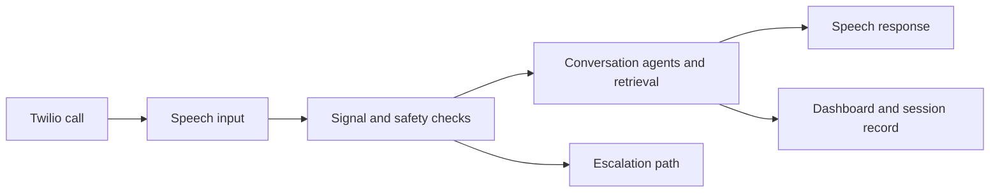

<div align="center">
  

  <p>
    
    
    
    <a href="LICENSE"></a>
  </p>
</div>

## ☎️ What it is

Sahayi is a voice-first health-companion prototype built around phone calls and Indic-language speech. Its backend connects telephony, speech recognition and synthesis, conversation orchestration, retrieval, and a browser dashboard.

<p align="center"></p>

## 🔄 Call path



## 🧰 Stack

| Area | Tools |
|---|---|
| Backend | Python, FastAPI, SQLAlchemy, SQLite, WebSockets |
| Telephony | Twilio Voice |
| Speech | Sarvam AI integrations |
| Models | Google Gemini and configured model clients |
| Retrieval | ChromaDB, sentence-transformers, PubMed E-utilities |
| Dashboard | React, Vite, Firebase Auth |

## 🚀 Run the components

Backend:

```bash
git clone https://github.com/ChristopherJoshy/Sahayi.git
cd sahayi/sahayi/backend
python -m venv .venv
# Windows: .venv\Scripts\Activate.ps1
# macOS/Linux: source .venv/bin/activate
pip install -r requirements.txt
Copy-Item .env.example .env  # PowerShell; use cp on macOS/Linux
uvicorn main:app --reload
```

Frontend, in another terminal:

```bash
cd sahayi/sahayi/frontend
npm install
npm run dev
```

Configure Twilio, Sarvam, model, database, and Firebase values locally. Do not put provider credentials in source control.

## 🗂️ Layout

```text
sahayi/backend/   API, call handling, agents, retrieval and safety logic
sahayi/frontend/  dashboard and session views
sahayi_flow.svg   high-level call flow
```

## 📄 License

MIT. See [`LICENSE`](LICENSE).

## ⚠️ Scope

This prototype is not a diagnostic or emergency-response service. It has not been clinically validated. Call recordings and health details are sensitive; use synthetic data for development and require qualified review before any real-world deployment.